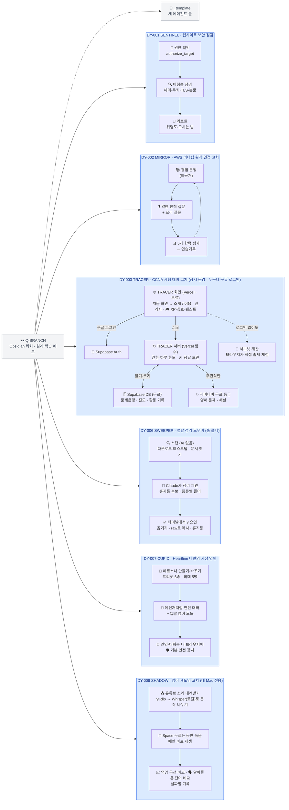

# 🕶️ Q-BRANCH · 나만의 에이전트 작업실

[](https://dodo-yong.github.io/Obsidian/)

**🌐 소개 페이지: https://dodo-yong.github.io/Obsidian/** · 🧠 [CCNA 코치 TRACER](https://tracer-eosin.vercel.app/ccna/) · 🗺️ [TRACER 작동 방식](https://tracer-eosin.vercel.app/ccna/about.html#how) · 🎧 [영어 섀도잉 SHADOW](https://dodo-yong.github.io/Obsidian/shadow/) · 💻 [터미널 작업 기록](https://dodo-yong.github.io/Obsidian/terminal.html) · 🧭 [작업실 지도](https://dodo-yong.github.io/Obsidian/map.html) (에이전트 + 만들기 도우미 + 자동 장치)

직접 설계·배포·운영하는 AI 에이전트 포트폴리오. 코드는 `agents/`, 설계·학습 메모는 Obsidian 위키(`wiki/`)에 있다.
에이전트에는 007처럼 번호와 코드명을 붙였다(나는 Agent DY). → [코드명 목록](wiki/shared/에이전트%20코드명.md)

## 🗺️ 프로젝트 지도



<sub>색: 🟨 기획 · 🟦 초기 버전·개발중 · 🟩 완료 · DY-004·005는 정리돼 빈 번호</sub>

## 📋 에이전트 목록

| 번호 · 코드명 | 한 줄 설명 | 상태 | 코드 | 메모 |
|---|---|---|---|---|
| 🛡️ DY-001 **SENTINEL** | URL을 주면 공격 없이 응답만 읽어 보안 약점을 찾고, 위험도와 고치는 법을 리포트로 써 줌 | 🟦 초기 버전 | [agents/security-agent](agents/security-agent) | [위키](wiki/projects/security-agent/security-agent.md) · [1일차 기록](https://dodo-yong.github.io/security-agent/) |
| 🎤 DY-002 **MIRROR** | AWS 16가지 리더십 원칙 면접 연습. 약한 원칙부터 묻고, 꼬리 질문으로 파고든 뒤 STAR·수치·원칙 적합도로 평가 | 🟦 초기 버전 | [agents/interview-coach](agents/interview-coach) | [위키](wiki/projects/interview-coach/interview-coach.md) |
| 🧠 DY-003 **TRACER** | CCNA 200-301 연습 사이트. 단원·범위를 골라 **영어 문제**를 받고 **영어 해설**(고른 보기가 왜 틀렸는지까지). 구글 로그인 · 진도는 계정에 저장 · XP·칭호·퀘스트·배지. Vercel + Supabase 무료로 항상 운영, 한 번 만든 문제는 **문제은행**에 저장해 다시 씀, 관리자 페이지(사용자 권한·활동 기록·문제 검토). [소개](https://tracer-eosin.vercel.app/ccna/about.html) · [작동 방식 그림](https://tracer-eosin.vercel.app/ccna/about.html#how) | 🟦 상시 운영 · 공개 (구글 로그인·문제은행·관리자) | [agents/ccna-coach](agents/ccna-coach) · [**사이트**](https://tracer-eosin.vercel.app/ccna/) | [위키](wiki/projects/ccna-coach/ccna-coach.md) |
| 🧹 DY-006 **SWEEPER** | 홈 폴더 정리 도우미. 다운로드·데스크탑 현황과 휴지통 후보, 흩어진 문서를 위키 `raw/`로 모으기, 폴더를 종류별로 정리. 스캔은 코드(사용량 0), 옮기기·지우기는 터미널에서 직접 승인·휴지통만 | 🟦 초기 버전 | [agents/laptop-helper](agents/laptop-helper) | [위키](wiki/projects/laptop-helper/laptop-helper.md) |
| 💗 DY-007 **CUPID** | Heartline: 내 취향대로 만드는 나만의 가상 연인 웹앱. 성격·말투·호칭·관계를 정하고(프리셋 6종·실시간 미리보기), 최대 5명을 바꿔 가며 메신저처럼 톡해요. 부가로 영어 모드(교정 카드) | 🟦 초기 버전 | [agents/heartline](agents/heartline) · [**앱**](https://dodo-yong.github.io/Obsidian/heartline/) | [위키](wiki/projects/heartline/heartline.md) · [PRD](wiki/projects/heartline/topics/Heartline%20PRD_261119.md) · [**PRD 페이지**](https://dodo-yong.github.io/Obsidian/heartline/prd.html) · [체크리스트](https://dodo-yong.github.io/Obsidian/heartline/checklist.html) · [테스트](https://dodo-yong.github.io/Obsidian/heartline/tests.html) · [발표](https://dodo-yong.github.io/Obsidian/heartline/deck.html) |
| 🎧 DY-008 **SHADOW** | 영어 섀도잉 코치(내 Mac 전용). 유튜브 주소를 넣으면 소리를 내려받아 문장 단위로 나누고, 문장을 듣고 **Space를 누르는 동안 녹음 → 떼면 바로 재생**. 원본과 내 **억양 곡선**, Whisper가 **알아들은 단어**를 비교하고 녹음은 날짜별로 쌓임. 모두 로컬·추가 비용 0원 | 🟦 초기 버전 · 개인용 | [agents/shadowing-coach](agents/shadowing-coach) · [**열기**](https://dodo-yong.github.io/Obsidian/shadow/) | [위키](wiki/projects/shadowing-coach/shadowing-coach.md) |

## 🧠 TRACER 쓰는 법

**주소: https://tracer-eosin.vercel.app/ccna/** — 처음 화면에서 "소개 보기" / "바로 이용하기"를 고른다. (예전 github.io 주소로 와도 자동 이동)

- **누구나**: 오른쪽 위 **Google로 로그인** → 범위·난이도 고르고 **문제 받기** → 답을 내면 해설과 XP. 진도는 계정에 저장돼 다른 기기에서도 이어진다. 로그아웃도 오른쪽 위. 서브넷 계산은 로그인 없이 바로.
- **무료 한도 보호**: 사람마다 하루 AI 30회(관리자가 조정), 전체 하루 300회. 객관식은 미리 채운 문제은행(1,808문제)에서만 나와 AI를 안 부르고, AI는 주관식에만 쓴다.
- **주인(나)**: [관리자 페이지](https://tracer-eosin.vercel.app/ccna/admin.html)에서 사용자 권한·차단·한도, 활동 기록, 신고된 문제를 관리. 내 Mac은 꺼져 있어도 된다.
- 페이지: [소개](https://tracer-eosin.vercel.app/ccna/about.html) · [이용](https://tracer-eosin.vercel.app/ccna/app.html) · [개인정보 처리방침](https://tracer-eosin.vercel.app/ccna/privacy.html) · 구성·배포: [agents/ccna-coach/README.md](agents/ccna-coach/README.md), [SETUP.md](agents/ccna-coach/SETUP.md)

## 🌐 공개 사이트 (GitHub Pages, `docs/`)

| 페이지 | 주소 | 파일 |
|---|---|---|
| 소개 (Q-BRANCH) | https://dodo-yong.github.io/Obsidian/ (TRACER 원리: `#how`) — 작업 기록은 하루 6개가 넘으면 핵심만 보이고 '더 보기'로 접힘 | `docs/index.html`, `style.css` |
| TRACER (CCNA 코치) | **https://tracer-eosin.vercel.app/ccna/** (Vercel에서 운영 · github.io `/ccna/`는 자동 이동) — 처음 화면 · `about.html` 소개 · `app.html` 이용 · `admin.html` 관리자 · `privacy.html` | `docs/ccna/*`, `docs/api/` (서버), `docs/vercel.json` |
| TRACER 작동 방식 (공용) | Q-BRANCH `#how`와 TRACER 소개(`about.html#how`)에 함께 들어감 | `docs/tracer-how.js`, `docs/tracer-how.css` — 여기만 고치면 두 곳이 같이 바뀜 |
| 터미널 작업 기록 | https://dodo-yong.github.io/Obsidian/terminal.html | `docs/terminal.html` |
| SHADOW 열기 (섀도잉 코치) | https://dodo-yong.github.io/Obsidian/shadow/ — 개인 컴퓨터에서 SHADOW가 켜져 있으면 버튼 하나로 http://127.0.0.1:8777/ 로 연결 | `docs/shadow/index.html` |
| Heartline (CUPID 앱) | https://dodo-yong.github.io/Obsidian/heartline/ (PRD `prd.html` · 체크리스트 `checklist.html` · 테스트 `tests.html` · 발표 `deck.html`) | `docs/heartline/` |

- 사이트를 고친 뒤엔 `scripts/bump-site-version.sh`로 버전을 올린다 → 열린 페이지가 새 버전을 감지하면 한 번 자동 새로고침(브라우저 캐시 대응). 공용 파일 주소의 `?v=`도 함께 올린다.
- 공개 문구는 "제 Mac" 대신 "개인 서버", "개인 컴퓨터 환경" 같은 공식 표현을 쓴다.
- `docs/ccna/server.json`은 예전 github.io 주소 방문자를 새 주소(`home`)로 보내는 안내판이다. (`start-public.sh`는 은퇴 — 켜면 안내판을 덮어쓴다)

## 📁 폴더 구조

```
agents/<이름>/          에이전트 코드 (프로젝트 하나 = 폴더 하나)
wiki/projects/<이름>/   설계·학습 메모 (Obsidian)
wiki/shared/            여러 프로젝트 공통 (코드명 목록·백업 현황·위키 효과 측정·나)
wiki/_규칙/             위키 상세 규칙 (작업·페이지 작성) — CLAUDE.md는 요약판, 필요할 때만 읽음
docs/                   공개 사이트 (소개·TRACER·터미널 기록)
scripts/                도구 스크립트 (아래 표)
tools/                  분석 도구 (위키 A/B 측정)
raw/                    원본 자료 (읽기 전용)
private/                비공개 — 이 저장소에서 제외, 별도 비공개 저장소로 백업
```

| 스크립트 | 하는 일 |
|---|---|
| `scripts/backup-private.sh` | `private/`를 비공개 저장소에 백업 (푸시 전 비공개 여부 확인) |
| `scripts/bump-site-version.sh` | 공개 사이트 버전 올리기 (자동 새로고침용, `tracer-how.*?v=` 포함) + 아래 git log 상자 갱신 |
| `scripts/work-report.py` | 매일 밤 10시 작업 보고 메일(일요일엔 주간 보고 함께). 커밋·log를 모아 제미나이가 요약, Gmail 앱 비밀번호로 발송. 예약은 `scripts/com.dodo-yong.work-report.plist`(launchd) |
| `scripts/journal-site.py` | 공개 [작업 일지](https://dodo-yong.github.io/Obsidian/journal/)(일자별·주별) 데이터 `docs/journal/data.json` 만들기. 공개 저장소 커밋·log만 읽고 제미나이가 쉬운 말로 요약. 매일 밤 작업 보고 뒤 자동 갱신·푸시, `backfill`로 지난 기록 채움 |
| `scripts/profile-readme.py` | GitHub 프로필(영문 이력서) README = `scripts/profile/README.template.md` + 최근 작업 일지(영어). 매일 밤 일지 갱신 뒤 자동으로 올림 |
| `scripts/update-site-log.py` | 소개 페이지 맨 위 git log 상자를 실제 커밋으로 다시 만듦. 하루 커밋이 많으면 4개만 보이고 '외 N개'로 축약(서버 주소 갱신 등 잡음 제외, 최근 3일만 펼침). 먼저 보여 줄 커밋·문구는 `docs/gitlog-highlights.txt` |
| `tools/wiki_ab_test.py` | 같은 질문을 위키로·위키 없이 답하게 해 토큰·시간 비교 (구독 사용량 듦, `--dry-run`은 0) → [결과](wiki/shared/위키%20효과%20측정.md) |

## 🔒 비밀 정보 다루는 법

- **API 키·토큰** → 볼트 `.env`에만 저장. git에 자동으로 안 올라간다. 형식은 `.env.example`로 공유.
- **💸 추가 비용 없음** → Claude 에이전트는 구독 로그인으로만 실행(API 키가 있으면 실행 거부), 제미나이는 무료 등급, 사이트·터널도 무료.
- **올리기 싫은 문서·메모** → `private/`에 둔다(공개 저장소에서 제외, 비공개 저장소로 따로 백업).
- **안전장치** → 커밋 직전 검사(`.githooks/pre-commit`)가 키 모양 문자열이나 `.env` 파일을 발견하면 커밋을 막는다.
- 이 저장소를 새로 clone했다면 한 번 실행: `git config core.hooksPath .githooks`

## ⚙️ 동기화

Obsidian Git 플러그인이 편집이 5분 멈추면 자동으로 커밋·푸시한다(Obsidian이 켜져 있을 때).
