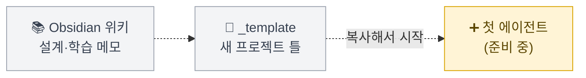

# 🤖 나만의 에이전트 만들기

수업에서 만드는 AI 에이전트 프로젝트 모음. 코드는 `agents/`, 설계·학습 메모는 Obsidian 위키(`wiki/`)에 있다.

## 🗺️ 프로젝트 지도



<sub>색: 🟨 기획 · 🟦 개발중 · 🟩 완료</sub>

## 📋 프로젝트 목록

| 프로젝트 | 한 줄 설명 | 상태 | 코드 | 메모 |
|---|---|---|---|---|
| *(첫 프로젝트를 시작하면 여기에 추가)* | | | | |

## 📁 폴더 구조

```
agents/<이름>/          에이전트 코드 (프로젝트 하나 = 폴더 하나)
wiki/projects/<이름>/   설계·학습 메모 (Obsidian)
raw/                    원본 자료 (읽기 전용)
```

## 🔒 비밀 정보 다루는 법

- **API 키·토큰** → 각 폴더의 `.env`에만 저장. git에 자동으로 안 올라간다. 형식은 `.env.example`로 공유.
- **올리기 싫은 문서·메모** → 아무 곳에나 `private/` 폴더를 만들어 넣거나, 파일명을 `이름.private.md`처럼 짓는다.
- **안전장치** → 커밋 직전 검사(`.githooks/pre-commit`)가 키 모양 문자열이나 `.env` 파일을 발견하면 커밋을 막는다.
- 이 저장소를 새로 clone했다면 한 번 실행: `git config core.hooksPath .githooks`

## ⚙️ 동기화

Obsidian Git 플러그인이 편집이 5분 멈추면 자동으로 커밋·푸시한다(Obsidian이 켜져 있을 때).
