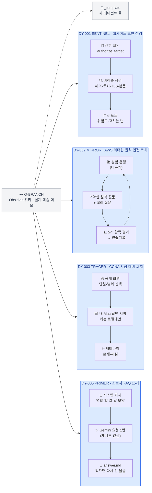

# 🕶️ Q-BRANCH · 나만의 에이전트 작업실

[](https://dodo-yong.github.io/Obsidian/)

**🌐 소개 페이지: https://dodo-yong.github.io/Obsidian/** · 🧠 [CCNA 코치 TRACER](https://dodo-yong.github.io/Obsidian/ccna/) · 💻 [터미널 작업 기록](https://dodo-yong.github.io/Obsidian/terminal.html)

AWS 인턴십 과정에서 Claude Code로 나에게 필요한 에이전트를 하나씩 만들어 보는 학습 기록. 코드는 `agents/`, 설계·학습 메모는 Obsidian 위키(`wiki/`)에 있다.
에이전트에는 007처럼 번호와 코드명을 붙였다(나는 Agent DY). → [코드명 목록](wiki/shared/에이전트%20코드명.md)

## 🗺️ 프로젝트 지도



<sub>색: 🟨 기획 · 🟦 초기 버전·개발중 · 🟩 완료</sub>

## 📋 에이전트 목록

| 번호 · 코드명 | 한 줄 설명 | 상태 | 코드 | 메모 |
|---|---|---|---|---|
| 🛡️ DY-001 **SENTINEL** | URL을 주면 공격 없이 응답만 읽어 보안 약점을 찾고, 위험도와 고치는 법을 리포트로 써 줌 | 🟦 초기 버전 | [agents/security-agent](agents/security-agent) | [위키](wiki/projects/security-agent/security-agent.md) · [1일차 기록](https://dodo-yong.github.io/security-agent/) |
| 🎤 DY-002 **MIRROR** | AWS 16가지 리더십 원칙 면접 연습. 약한 원칙부터 묻고, 꼬리 질문으로 파고든 뒤 STAR·수치·원칙 적합도로 평가 | 🟦 초기 버전 | [agents/interview-coach](agents/interview-coach) | [위키](wiki/projects/interview-coach/interview-coach.md) |
| 🧠 DY-003 **TRACER** | CCNA 단원별 문제·해설 사이트. 화면은 공개, 답변은 키가 있는 내 Mac 서버가 제미나이로 | 🟦 초기 버전 | [agents/ccna-coach](agents/ccna-coach) · [화면](https://dodo-yong.github.io/Obsidian/ccna/) | [위키](wiki/projects/ccna-coach/ccna-coach.md) |
| 💬 DY-004 **TWIN** | 터미널에서 구글 제미나이와 대화 (키는 `.env`, 대화 기록은 볼트 밖) | 사용 중 | [scripts/gemini.py](scripts/gemini.py) | [위키](wiki/shared/gemini-chat.md) |
| 📝 DY-005 **PRIMER** | 내 분야 초보자가 자주 묻는 질문 15개와 두 줄 답을 Gemini에게 한 번 받아 `answer.md`로 저장 | 🟦 초기 버전 | [agents/beginner-faq](agents/beginner-faq) | — |

## 📁 폴더 구조

```
agents/<이름>/          에이전트 코드 (프로젝트 하나 = 폴더 하나)
wiki/projects/<이름>/   설계·학습 메모 (Obsidian)
docs/                   소개 페이지·CCNA 화면 (GitHub Pages)
raw/                    원본 자료 (읽기 전용)
```

## 🔒 비밀 정보 다루는 법

- **API 키·토큰** → 볼트 `.env`에만 저장. git에 자동으로 안 올라간다. 형식은 `.env.example`로 공유.
- **올리기 싫은 문서·메모** → `private/`에 둔다(공개 저장소에서 제외, 비공개 저장소로 따로 백업).
- **안전장치** → 커밋 직전 검사(`.githooks/pre-commit`)가 키 모양 문자열이나 `.env` 파일을 발견하면 커밋을 막는다.
- 이 저장소를 새로 clone했다면 한 번 실행: `git config core.hooksPath .githooks`

## ⚙️ 동기화

Obsidian Git 플러그인이 편집이 5분 멈추면 자동으로 커밋·푸시한다(Obsidian이 켜져 있을 때).
