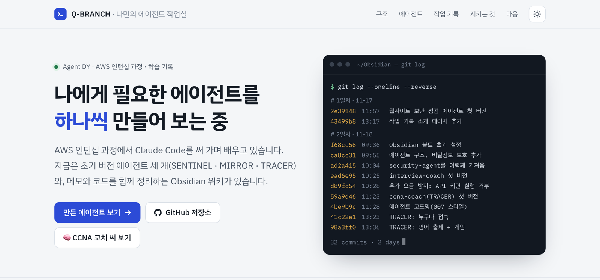
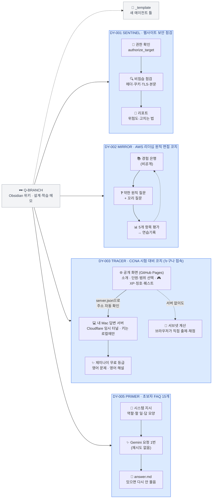

# 🕶️ Q-BRANCH · 나만의 에이전트 작업실

[](https://dodo-yong.github.io/Obsidian/)

**🌐 소개 페이지: https://dodo-yong.github.io/Obsidian/** · 🧠 [CCNA 코치 TRACER](https://dodo-yong.github.io/Obsidian/ccna/) · 💻 [터미널 작업 기록](https://dodo-yong.github.io/Obsidian/terminal.html)

AWS 인턴십 과정에서 Claude Code로 나에게 필요한 에이전트를 하나씩 만들어 보는 학습 기록. 코드는 `agents/`, 설계·학습 메모는 Obsidian 위키(`wiki/`)에 있다.
에이전트에는 007처럼 번호와 코드명을 붙였다(나는 Agent DY). → [코드명 목록](wiki/shared/에이전트%20코드명.md)

## 🗺️ 프로젝트 지도



<sub>색: 🟨 기획 · 🟦 초기 버전·개발중 · 🟩 완료</sub>

## 📋 에이전트 목록

| 번호 · 코드명 | 한 줄 설명 | 상태 | 코드 | 메모 |
|---|---|---|---|---|
| 🛡️ DY-001 **SENTINEL** | URL을 주면 공격 없이 응답만 읽어 보안 약점을 찾고, 위험도와 고치는 법을 리포트로 써 줌 | 🟦 초기 버전 | [agents/security-agent](agents/security-agent) | [위키](wiki/projects/security-agent/security-agent.md) · [1일차 기록](https://dodo-yong.github.io/security-agent/) |
| 🎤 DY-002 **MIRROR** | AWS 16가지 리더십 원칙 면접 연습. 약한 원칙부터 묻고, 꼬리 질문으로 파고든 뒤 STAR·수치·원칙 적합도로 평가 | 🟦 초기 버전 | [agents/interview-coach](agents/interview-coach) | [위키](wiki/projects/interview-coach/interview-coach.md) |
| 🧠 DY-003 **TRACER** | CCNA 200-301 연습 사이트. 단원·범위를 골라 **영어 문제**를 받고 **영어 해설**까지. 누구나 접속, XP·칭호·퀘스트·배지. 화면은 공개, 답변은 키가 있는 내 Mac 서버가 제미나이로 | 🟦 초기 버전 · 공개 | [agents/ccna-coach](agents/ccna-coach) · [**사이트**](https://dodo-yong.github.io/Obsidian/ccna/) | [위키](wiki/projects/ccna-coach/ccna-coach.md) |
| 💬 DY-004 **TWIN** | 터미널에서 구글 제미나이와 대화 (키는 `.env`, 대화 기록은 볼트 밖) | 사용 중 | [scripts/gemini.py](scripts/gemini.py) | [위키](wiki/shared/gemini-chat.md) |
| 📝 DY-005 **PRIMER** | 내 분야 초보자가 자주 묻는 질문 15개와 두 줄 답을 Gemini에게 한 번 받아 `answer.md`로 저장 | 🟦 초기 버전 | [agents/beginner-faq](agents/beginner-faq) | — |

## 🧠 TRACER 쓰는 법

- **방문자**: https://dodo-yong.github.io/Obsidian/ccna/ 를 열면 끝. 가입·코드 없음. 오른쪽 위가 "AI 연결됨"이면 AI 문제·해설, "AI 꺼짐"이어도 서브넷 계산은 언제나 가능. 레벨·퀘스트·배지는 각자 브라우저에 저장.
- **주인(나)**: 내 Mac에서 아래를 켜 두면 공개 사이트가 자동으로 연결된다. 끄면 자동으로 "AI 꺼짐".
  ```bash
  cd ~/Obsidian/agents/ccna-coach && ./start-public.sh
  ```
  - 방문자는 1명당 시간당 30번 · 방문자 전체 하루 300번(무료 한도 보호). 내 진도는 이 Mac에서 http://127.0.0.1:8765
  - 자세한 내용: [agents/ccna-coach/README.md](agents/ccna-coach/README.md)

## 🌐 공개 사이트 (GitHub Pages, `docs/`)

| 페이지 | 주소 | 파일 |
|---|---|---|
| 소개 (Q-BRANCH) | https://dodo-yong.github.io/Obsidian/ | `docs/index.html` |
| TRACER (CCNA 코치) | https://dodo-yong.github.io/Obsidian/ccna/ | `docs/ccna/index.html`, `topics.json`, `server.json` |
| 터미널 작업 기록 | https://dodo-yong.github.io/Obsidian/terminal.html | `docs/terminal.html` |

- 사이트를 고친 뒤엔 `scripts/bump-site-version.sh`로 버전을 올린다 → 열린 페이지가 새 버전을 감지하면 한 번 자동 새로고침(브라우저 캐시 대응).
- `docs/ccna/server.json`은 `start-public.sh`가 켜고 끌 때 자동으로 갱신·커밋한다.

## 📁 폴더 구조

```
agents/<이름>/          에이전트 코드 (프로젝트 하나 = 폴더 하나)
wiki/projects/<이름>/   설계·학습 메모 (Obsidian)
wiki/shared/            여러 프로젝트 공통 (코드명 목록·백업 현황·나)
docs/                   공개 사이트 (소개·TRACER·터미널 기록)
scripts/                도구 스크립트 (아래 표)
raw/                    원본 자료 (읽기 전용)
private/                비공개 — 이 저장소에서 제외, 별도 비공개 저장소로 백업
```

| 스크립트 | 하는 일 |
|---|---|
| `scripts/gemini.py` | DY-004 TWIN: 터미널에서 제미나이와 대화 |
| `scripts/backup-private.sh` | `private/`를 비공개 저장소에 백업 (푸시 전 비공개 여부 확인) |
| `scripts/bump-site-version.sh` | 공개 사이트 버전 올리기 (자동 새로고침용) |

## 🔒 비밀 정보 다루는 법

- **API 키·토큰** → 볼트 `.env`에만 저장. git에 자동으로 안 올라간다. 형식은 `.env.example`로 공유.
- **💸 추가 비용 없음** → Claude 에이전트는 구독 로그인으로만 실행(API 키가 있으면 실행 거부), 제미나이는 무료 등급, 사이트·터널도 무료.
- **올리기 싫은 문서·메모** → `private/`에 둔다(공개 저장소에서 제외, 비공개 저장소로 따로 백업).
- **안전장치** → 커밋 직전 검사(`.githooks/pre-commit`)가 키 모양 문자열이나 `.env` 파일을 발견하면 커밋을 막는다.
- 이 저장소를 새로 clone했다면 한 번 실행: `git config core.hooksPath .githooks`

## ⚙️ 동기화

Obsidian Git 플러그인이 편집이 5분 멈추면 자동으로 커밋·푸시한다(Obsidian이 켜져 있을 때).
