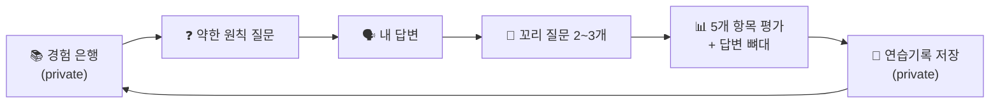

# 🎤 DY-002 MIRROR — AWS 리더십 원칙 면접 코치 (`interview-coach`)

> AWS 인턴십 행동 면접(16 Leadership Principles)을 연습하는 대화형 에이전트.
> 내 경험 은행을 읽고 **약한 원칙부터** 질문하고, **꼬리 질문으로 파고든 뒤** 평가한다.

- **상태**: 개발중
- **위키 메모**: `wiki/projects/interview-coach/`

## 동작


| 평가 항목 | 보는 것 |
|---|---|
| STAR 구조 | 상황·과제·행동·결과가 분명한가 |
| 본인 행동 | "we"가 아니라 "I", 구체적 행동 |
| 결과 구체성 | 수치·전후 비교 |
| 원칙 적합도 | 해당 LP를 잘 보여 주는가 |
| 전달력 | 2~3분, 핵심부터 |

## 🔒 개인 데이터는 코드와 분리
- 코드(이 폴더)는 공개 저장소에 올라가지만, **경험·연습기록은 볼트의 `private/interview-coach/`에만** 읽고 쓴다(git 제외).
- 시작할 때 데이터 폴더가 git 제외 상태인지 검사하고, 아니면 저장을 거부한다.
- 코치는 자기 전용 도구 7개만 쓸 수 있다(파일 읽기·쓰기·명령 실행 등 기본 도구 차단).

## 실행 (맥)
```bash
cd agents/interview-coach
python3 -m venv .venv && .venv/bin/pip install -r requirements.txt   # 처음 한 번
./run.sh
```
- 시작하면 언어 모드(`ko` / `en` / `mix`)와 연습할 원칙(엔터 = 코치 추천)을 묻는다.
- 💸 **추가 요금 없음**: Claude 구독 로그인으로만 실행한다. `ANTHROPIC_API_KEY`가 설정돼 있으면 실행을 거부한다.
  화면의 "$" 금액은 API 요금 *환산* 참고치이고 실제 청구가 아니다(구독 사용량에서 차감).
- 종료: `exit`

## 도구
| 도구 | 하는 일 |
|---|---|
| `get_progress` | 원칙별 연습 횟수·평균 점수·연결된 경험 수 |
| `list_principles` | 16개 원칙 풀이와 질문 씨앗 |
| `list_experiences` / `read_experience` | 경험 은행 목록·읽기 |
| `save_session` | 연습 결과 저장 |
| `save_experience` | 새 경험을 초안으로 저장(동의 시, 덮어쓰기 없음) |
| `current_datetime` | 현재 시각 |

## 파일
| 파일 | 설명 |
|---|---|
| `main.py` | 에이전트 본체(시스템 프롬프트·도구·권한) |
| `principles.py` | 16개 원칙 풀이·질문 씨앗 (원문 번역 아님, 공식 원문은 amazon.jobs) |
| `run.sh` | `.env` 읽고 실행 |
