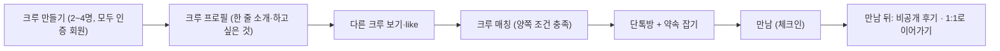

# 👯 소개팅 앱 그룹 미팅(크루) 기능 (브레인스토밍 v0)

상위: [[dating]] · 바탕: [[소개팅 앱 핵심 가설·차별점_261123]]

> 사용자 아이디어(2026-11-24): 혼자 나가면 위험할 수 있고, 친구를 데려가면 상대가 부담스러워한다. 그러면 **처음부터 친구끼리 한 팀으로 매칭해서 같이 만나면** 된다. 파티하고 싶을 때도 쓸 수 있다. 아래는 제미나이가 이 아이디어를 넓혀 정리한 것이다. **정한 것은 "솔로·크루 선택형" 하나뿐**(12절)이고, Claude가 다시 점검할 예정.

## 1. 한 줄 정의
**친구 2~4명이 "크루"를 만들어, 다른 크루와 매칭하고, 같이 만나서 노는 기능.** 한국의 "미팅" 문화를 앱으로 옮긴 것.
- 한국어 이름 후보: 미팅 · 크루 미팅 / 영어 후보: Crew · Squad Date · "Bring your girls"

## 2. 왜 우리 앱에 잘 맞나
| 여성이 떠나는 이유 (핵심 가설) | 크루 미팅이 푸는 방법 |
|---|---|
| **위험** (모르는 사람과 단둘이) | 친구가 처음부터 옆에 있다. 공공장소에서 여럿이 만난다 |
| **불쾌함** (무례한 메시지) | 단톡방이라 친구 앞에서 무례하게 굴기 어렵다 |
| **피로** (1:1 연락 부담) | 대화를 크루가 나눠서 하니 혼자 답장하지 않아도 된다 |
| **기대 차이** ("친구 데려왔어?" 부담) | 처음부터 그룹 만남이라 양쪽 기대가 같다 |

- 원칙과도 맞는다: **여성 크루가 통제하고, 남성 크루가 노력한다**(4절).
- **성장 장치**: 여성이 친구를 데려올 이유가 생긴다 → "첫 여성 100명" 문제에 도움(친구 묶음으로 들어옴).
- **타지 정체성**: 서울 외국인·미국 유학생은 친구끼리 어울리는 문화가 강하고, "새 도시에서 친구도 사귀기"로도 쓸 수 있다.

## 3. 기본 흐름

1. **크루 만들기**: 한 사람이 만들고 친구를 초대 → 친구가 **직접 수락해야** 들어감(남이 나를 크루에 넣을 수 없음). 모두 같은 도시, 사진 인증 회원, 19+.
2. **크루 프로필**: 멤버 각자의 프로필 묶음 + 크루 한 줄("보드게임 좋아하는 대학원생 셋") + 하고 싶은 것(🍻 술 · ☕ 카페 · 🎳 놀거리 · 🎉 파티 · 🍽 밥). 크루 사진은 멤버 전원이 동의한 것만.
3. **보기·like**: 인원이 같거나 비슷한 크루만 보인다(2:2, 3:3, ±1명 허용은 설정).
4. **매칭 → 단톡방**: 양쪽 크루 멤버 전원이 있는 대화방. 약속 잡기 도구(날짜 투표·장소 후보).
5. **만남·만남 뒤**: 7절의 안전 장치 + 1:1로 이어가기(서로 동의할 때만).

## 4. 여성 우선 규칙을 크루에 적용
| 개인 기능 (지금) | 크루판 |
|---|---|
| 남성 like는 한마디 필수 | **남성 크루 like는 한마디 필수**(여성 크루가 걸어 둔 질문에 답) |
| 받은 like는 여성이 고름 | **여성 크루가 받은 크루 like를 골라서** 매칭 |
| 여성 목적 선택·남성 목적 필수 | 남성 크루는 **멤버 전원의 목적이 공개**됨. 여성 크루는 크루 목적만 선택(예: "그냥 놀기") |
| Opening Moves | 여성 크루가 "우리가 먼저 / 우리 질문에 답하면 시작" 선택 |
| Your Turn Limits | 남성 크루가 동시에 걸 수 있는 like·진행 중인 매칭 수 제한 |

> ✅ 해결(2026-11-24 사용자 결정): 아래 "과반 동의"·"한 명이 보내면 전원 이름" 대신 **양쪽 크루 모두 전원 동의**(12절).

- **매칭 성립 조건(제안)**: 여성 크루 쪽은 **과반 동의**(한 명이 싫다면 거부권 옵션), 남성 크루는 한 명이 like를 보내도 크루 전원 이름으로 나감 → 남성 크루 안에서 "누가 보냈는지"는 크루 안에서만 보임.
- **약속 장소**: 여성 크루가 장소 후보를 고르거나 승인. 기본 추천은 사람 많은 공공장소.
- **혼성·동성 크루**: 시작은 "여성 크루 ↔ 남성 크루"만. 혼성 크루는 파티 모드에서 검토(5절).

## 5. 모드 넓히기
| 모드 | 내용 | 시기 제안 |
|---|---|---|
| **미팅** | 크루 대 크루(2:2·3:3·4:4) | **처음** |
| **친구 크루** | 같은 성별 크루끼리도 매칭("👋 친구" 목적과 연결). 타지에서 친구 사귀기 | 미팅 뒤 |
| **파티·모임** | 한 크루가 모임을 열고(예: "토요일 홍대 볼링, 6명 더"), 여러 크루·사람이 신청 → 주최 크루가 승인 | 밀도가 생긴 뒤 |
| **운영자 행사** | 운영자가 직접 여는 오프라인 모임(첫 여성 모으기·후기 콘텐츠) | 시험판 때 오프라인으로 먼저 |

> 파티 모드는 음주·사적인 장소 위험이 커서 **공공장소만 · 주최자 인증 · 정원 제한 · 앱이 술자리를 홍보하지 않음**이 전제(앱스토어 성적 콘텐츠 심사와도 관련).

## 6. 상대(남성) 쪽 부담도 줄인다
- "친구 데려왔어?" 같은 서운함이 없다 — 처음부터 그룹.
- 1:1 소개팅이 어색한 남성도 친구와 같이 나오니 진입 장벽이 낮다 → 매너 좋은 남성이 들어올 이유.
- 매너 배지("Not a Hongdae boy ✅")를 **크루 단위로도** 보여 줌(멤버 전원이 배지가 있으면 크루 배지).

## 7. 안전 장치 (영원히 무료)
- **크루 전원 인증**: 앱 안 쓰는 친구를 "게스트"로 데려오는 건 **안 됨**(인증 안 된 사람이 끼면 안전 약속이 깨짐). 대신 친구 초대 링크 → 단, 시험판은 운영자 초대만(9절).
- **우리끼리 방**: 크루 멤버만 있는 비밀 대화방. 만남 중 "이 크루 별로야" 같은 신호를 나눔.
- **만남 체크인**: 약속 시각에 "다 모였어요" · 끝날 때 "모두 잘 들어갔어요?" 버튼(크루 안에서만 보임). 안 누르면 크루 친구에게 알림(Share Date의 크루판).
- **크루 신고**: 크루 전체 신고 + 특정 멤버 신고 둘 다. 사유 추가: "🚩 작업 크루(여성 한 명을 노리고 몰려옴)", "🚩 나온 사람이 프로필과 다름", "🚩 술 강요".
- **노출 줄이기**: 남성 크루 중 한 명이라도 신고 기준을 넘으면 그 크루 전체 노출을 줄임 → 친구끼리 서로 책임지게.
- **크루 전원 사진 비교**: 만남 전에 "오늘 나올 사람" 확정 → 다른 사람이 나오면 신고 사유.
- **탈퇴·해체 자유**: 누구든 언제든 크루에서 나갈 수 있고, 나가면 그 크루의 단톡방에서도 빠짐(대화 사본은 신고 때만).

## 8. 만남 뒤: 1:1로 이어가기
- 단톡방 안에서 멤버를 골라 **조용히 like** → 서로 like하면 그때 1:1 대화방이 열림(상대가 안 고르면 아무도 모름 → 거절 부담 없음).
- 이건 개인 매칭과 같은 규칙(차단·신고·대화 필터)을 그대로 따름.

## 9. 지금 결정·코드와 부딪히는 점
- ⚠️ **초대 결정과 충돌**: 시험판은 "운영자가 나이를 아는 사람에게만 초대, 초대받은 사람은 남을 초대 못 함"(2026-11-24). 크루 친구 초대도 **운영자 초대 회원끼리만** 크루를 짤 수 있게 해야 함. 공개 출시(본인인증) 뒤에 친구 초대 링크.
- **밀도 문제**: 1:1보다 매칭이 훨씬 어렵다(크루 수 = 사람 수 ÷ 3). 서울 시험판 인원으로는 앱 안 매칭보다 **운영자가 직접 주선하는 미팅 몇 번**이 현실적일 수 있음.
- **일정 맞추기**: 6~8명 일정이 맞기 어려움 → "이번 주 가능한 날"을 크루 프로필에 미리 표시.
- **DB·RLS 영향(대략)**: `crews`·`crew_members`(초대·수락)·`crew_likes`·`crew_matches`·단톡방 메시지(지금 메시지는 1:1 구조)·크루 신고. 사진 보기 조건("서로 후보·매칭 상대")을 크루로 넓혀야 해서 **RLS가 꽤 커짐**. 채팅 실시간 수신(보드에 있음)이 먼저 필요.
- **개인정보**: 크루 멤버가 서로의 프로필을 보게 되므로 크루 가입 때 고지. 처리방침에 "크루 기능" 항목 추가 필요.

## 10. 비슷한 시도 (2026-11-24 Claude 검색으로 일부 확인)
- **Tinder Social**(2016 출시, 2017년쯤 종료): 기본값으로 켜져 있어 **페이스북 친구 중 누가 Tinder를 쓰는지 드러남**, 모르는 새 그룹에 넣어졌다는 불만도 있었음(TechCrunch·Macworld 2016). Tinder가 밝힌 종료 이유는 "앞으로의 방향과 맞지 않음"뿐이라 노출 문제가 원인이었는지는 확인 안 됨.
- **Grouper**(2011 뉴욕, 3:3 술자리 주선): 2014년 해외 운영 접고 인원 감축(VentureBeat), 2016년 종료(위키백과). 종료 이유는 믿을 만한 출처로 확인 못 함.
- 흔히 꼽는 이유(일반론): 친구에게 앱 사용이 드러나는 **노출 문제**, 일정 맞추기, 밀도. → 우리 설계는 **크루는 서로 수락한 친구끼리만**, **도시 단위 풀**로 대응. 출시 전 최신 자료로 다시 조사.

## 11. 단계 제안
1. **지금(시험판)**: 앱 기능 없이 **운영자 주선 오프라인 미팅**으로 수요 시험 → "친구랑 같이라면 더 나가겠다"는 여성이 많은지 확인(시험판 지표에 추가).
2. **공개 출시 후 1차**: 미팅 모드(여성 크루 ↔ 남성 크루, 2:2·3:3) + 단톡방 + 체크인 + 1:1 이어가기.
3. **2차**: 친구 크루(동성), 파티·모임 모드.

## 11-1. "솔로·크루 둘 다 고를 수 있으면 단점이 없지 않나?" (2026-11-24 질문)
- **사용자 쪽 단점은 거의 없다**: 고르는 것이라 크루가 싫으면 안 쓰면 된다.
- **남는 단점은 앱과 운영자 쪽**:
  1. **빈 방 효과**: 사람이 적을 때 크루 탭이 텅 비면 앱 전체가 죽은 것처럼 보인다. 또 사람들의 관심이 두 곳으로 나뉜다.
  2. **새로운 악용 경로**: 작업 크루, 친구인 척 꾸린 가짜 크루, 크루를 써서 like 한도 피하기. 솔로만 있으면 생기지 않는 위험이다.
  3. **신고 처리가 어려워짐**: 단톡방에서 누가 무엇을 했는지 가려야 하고, 크루 전체를 벌할지 한 명만 벌할지 판단해야 한다(운영자 한 명).
  4. **개발량**: 단톡방·크루 권한·실시간 수신 때문에 핵심 기능 개발이 늦어진다.
  5. **브랜드가 흐려짐**: 특히 파티 모드가 "놀자 앱"으로 보이면 진지한 여성이 떠날 수 있다.
  6. **여성 개인의 통제**: 크루 과반으로 매칭하면 내가 원하지 않는 매칭에 끌려갈 수 있다 → 개인 거부권이 필요하다.
- **줄이는 법**:
  - 프로필 하나로 솔로·크루 공유
  - like 한도는 개인 한도와 합쳐서 셈
  - 크루 탭은 도시에 크루가 일정 수 이상일 때만 보이기
  - 여성 멤버 한 명이라도 거부하면 매칭 안 됨
  - 파티 모드는 맨 나중
- **결론(제안)**: 선택형이면 넣을 가치가 크다. 다만 **언제 켜느냐**가 중요하다(11절 순서 그대로).

## 12. 사용자 결정 (2026-11-24)
- **크루 모드는 선택형**: 솔로(지금의 1:1)가 기본, 크루는 원하는 사람만.
- **다음 단계**: 이 정리를 그대로 두고, Claude Code를 다시 쓸 수 있을 때 아이디어를 다시 점검한다. → 점검 완료(13절).
- **13절 추천대로 결정**(2026-11-24 사용자 "추천대로"):
  - **시점**: 앱 기능은 미국 정식 출시 뒤 1:1이 자리 잡으면 1차로. 그전엔 코드 작업 없음.
  - **오프라인 주선·운영자 행사는 하지 않음**(2026-11-24 사용자: 오프라인으로 할 계획 없음). 5절 "운영자 행사", 11절 1단계는 취소. 수요 확인은 시험판 의견 묻기에 질문 하나로(제안: "친구와 같이 나가는 미팅 기능이 있으면 쓰겠어요?").
  - **매칭 조건**: 여성 크루·남성 크루 **모두 전원 동의**. 남성 쪽은 한 명이 제안 → 나머지가 정해진 시간 안에 수락해야 like가 나감.
  - **인원**: 2~3명, **같은 인원끼리만**(±1은 나중에 다시 판단).
  - **파티 모드**: 하지 않음.
  - **이름**: 앱 이름 정할 때 같이(영어 먼저).
  - **설계 규칙**(13-2·13-3): 멤버 사이 차단·신고가 하나라도 있으면 두 크루는 서로 안 보임, 선호는 모든 짝에서 맞아야 함, like·매칭 뒤엔 멤버 추가 금지(빼기만), 친구 찾기는 검색 말고 크루 초대 코드.

## 12-1. 아직 결정 대기
- 이름(앱 이름 정할 때)
- 친구 크루(동성)·혼성 크루 범위(1차 이후)
- 시험판 질문으로 수요 확인할지, "수요 있음" 기준

## 13. Claude 재점검 (2026-11-24)
> 제미나이 정리(1~12절)를 다시 봤다. 큰 방향(선택형·크루 전원 인증·공공장소·시험판은 오프라인 주선)은 그대로 좋다. 아래는 **빠졌거나 고칠 점**.

### 13-1. 매칭 조건: 양쪽 다 "전원 동의"로 (4절 고침 제안)
- **여성 크루 = 전원 동의**(한 명이라도 거부하면 안 됨). 과반이면 원하지 않는 여성이 끌려간다 → "여성이 통제" 원칙과 어긋남. 11-1절 결론과도 같다.
- **남성 크루도 전원 동의**로 바꾸는 게 맞다. 4절처럼 "한 명이 like 보내면 크루 전원 이름으로 나감"이면, 동의 안 한 남성이 매칭에 끌려가고 그 사람 사진·목적이 상대에게 보인다. Tinder Social도 "모르는 새 그룹에 넣어졌다"는 불만이 있었다(10절). → 한 명이 like를 **제안**, 나머지가 수락해야 나감(정해진 시간 안에 수락 안 하면 취소).

### 13-2. 차단이 크루를 뚫으면 안 된다 (안전, 빠져 있던 것)
- 두 크루의 **멤버 사이 아무 짝이라도 차단·신고 관계가 있으면** 두 크루는 서로 보이지도, 매칭되지도 않는다. 안 그러면 차단한 남성을 친구 크루 단톡방에서 다시 만난다.
- 개인 조건도 지킨다: 나이·도시·성별 선호가 **크루 사이 모든 짝에서** 맞아야 보인다(최소한 여성 쪽 선호는 지켜야 함). 지금 사진 공개 규칙("서로 후보·매칭 상대만")을 크루가 우회하면 안 된다.

### 13-3. like·매칭 뒤 멤버를 바꾸지 못하게
- like를 보낸 뒤나 매칭 뒤에 멤버를 **넣을 수 없다**(빼는 것만 됨). 안 그러면 여성 크루가 동의한 적 없는 사람을 끼워 넣을 수 있다 = 7절 "오늘 나올 사람 확정"보다 먼저 막아야 함.
- 누가 빠지면 상대 크루에 알리고, 인원이 바뀌면 상대 크루가 계속할지 다시 고른다.

### 13-4. 9절 보완
- **초대 결정과 충돌은 사실상 없다**: 시험판엔 운영자가 초대한 사람만 있으니, 크루는 "이미 가입한 사람끼리"만 짜면 된다. 단 친구를 찾는 방법(이름 검색)은 **누가 앱을 쓰는지 드러내는** Tinder Social의 실수 → 검색 말고 **크루 초대 코드를 친구에게 직접 건네는** 방식.
- **밀도**: 같은 도시·같은 인원·서로 전원 동의·일정까지 맞아야 해서 1:1보다 훨씬 어렵다. 폐쇄 시험판(운영자가 아는 사람만)에서 앱 기능은 의미가 없다 → 11절 1단계(운영자 오프라인 주선)에 동의. 다만 운영자가 양쪽을 다 아는 사이라 **어색함·소문** 부담이 있으니 참가는 늘 본인이 신청.
- **RLS·코드**: 단톡방은 지금 1:1 메시지 구조를 넓히는 게 아니라 새로 짜야 하고, 신고 때 대화 사본(최근 50개)·연락처 필터·"한마디 = 첫 메시지"(1c)도 단톡방판이 필요하다. 실시간 수신이 먼저. → **공개 출시 전엔 코드 작업 안 함**이 맞다.
- **체크인 효용**: 크루 친구는 이미 옆에 있으니 만남 중 체크인은 효과가 작다. 진짜 위험은 **흩어진 뒤·1:1로 이어간 뒤**다 → 체크인은 "잘 들어갔어요"와 1:1 첫 만남 쪽에 힘을 준다.

### 13-5. 추천 (결정은 사용자)
| 남은 결정 | 추천 |
|---|---|
| 시점 | 시험판 = 앱 기능 없이 운영자 오프라인 주선 1~2번으로 수요 확인 → 미국 정식 출시 뒤 1:1이 자리 잡으면 1차 |
| 여성 크루 매칭 조건 | 전원 동의(남성 크루도 전원) |
| 인원 | 2~3명으로 시작, 같은 인원끼리만(±1은 나중) |
| 파티 모드 | 하지 않음(브랜드·심사·음주 위험). 운영자 행사로 대신 |
| 이름 | 미국 먼저라 영어 이름이 먼저 필요 — 앱 이름 정할 때 같이 |
