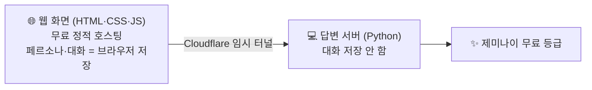

# 💗 Heartline PRD v0.6


> **한 줄**: **내 취향대로 만든 가상 연인**과 메신저로 톡하는 앱. 성격·말투·관계를 내가 정하고, 언제든 바꾸거나 여러 명을 둘 수 있다. 원하면 같은 상대와 영어 대화 연습도 한다.

진행 단계: **① PRD** → ② 체크리스트 → ③ 테스트 → ④ 앱 압축 파일 → ⑤ 발표 PPT

> v0.6 변경: 1순위를 **페르소나(나만의 연인 만들기·바꾸기)** 로 재정렬. 안전 장치는 유지하되 "기본 장치"로 간결하게.

---

## 1. 기본 구성요소

### 1.1 문제와 해결
- 기존 AI 챗봇은 누구에게나 같은 말투의 "도우미"라, **내 사람**이라는 느낌이 없다.
- Heartline은 **내가 원하는 사람을 직접 만드는 것**에서 시작한다. 성격·말투·호칭·관계·이야기를 정하면, 그 사람이 메신저 속 연인처럼 대화하고 나를 기억한다.
- 마음에 안 들면 **언제든 고치고**, 다른 분위기의 상대도 **여러 명** 둘 수 있다.
- 같은 상대와 **영어 대화**도 할 수 있어, 즐거운 대화가 자연스럽게 연습이 된다.

### 1.2 대상 사용자
| 사용자 | 원하는 것 |
|---|---|
| **나만의 연인을 원하는 사람** (핵심) | 내 취향의 성격·말투로 다정하게 대화하고 나를 기억해 주는 상대 |
| **기댈 사람이 필요한 사람** (핵심) | 언제든 말 걸 수 있고, 판단 없이 들어 주는 상대 |
| 영어 회화 연습이 필요한 사람 (부가) | 편한 상대와 부담 없는 영어 대화 |

### 1.3 핵심 기능 (MVP)
| ID | 기능 | 설명 |
|---|---|---|
| **F1** | **페르소나 만들기** ⭐ | 프리셋 6종 또는 직접 만들기. 아바타·이름·성별·나이대(성인) / 성격 슬라이더 4개 + 성격 키워드 / 말투·이모지·말버릇·호칭 / 관계 단계·사귄 날 / 직업·관심사·좋아하는 것·싫어하는 것 / 상태 메시지. **고르는 즉시 첫 인사 미리보기** |
| **F2** | **페르소나 바꾸기·여러 명** ⭐ | 메신저 친구 목록 같은 **대화 목록**(최대 5명). 상대마다 대화방·기억이 따로. 언제든 프로필 수정(대화는 유지)·삭제 |
| F3 | 연인 대화 | 메신저처럼(입력 중·말풍선 2~3개·읽음·💗). 페르소나 설정대로 말하고, 지난 대화를 기억해 이어 감 |
| F4 | 영어 모드 | 토글 하나로 같은 상대가 영어로 대화, 틀린 문장은 교정 카드 |
| F5 | 기본 안전 장치 | 1.5절 |

**프리셋 6종**: 다정한 연상 · 장난꾸러기 동갑 · 차분한 지적인 타입 · 츤데레 · 수줍은 연하 · 듬직한 어른 (성별은 사용자가 고름)

### 1.4 페르소나 설정 항목
| 묶음 | 항목 |
|---|---|
| 겉모습 | 아바타(이모지 8종 × 배경색 6종), 이름, 성별, 나이대(20대~60대 이상) |
| 성격 | 다정함·장난기·차분함·솔직함 슬라이더 + 키워드 최대 3개(다정 · 츤데레 · 장난꾸러기 · 어른스러움 · 수줍음 · 시크 · 낙천적 · 다혈질) |
| 말투 | 반말/존댓말, 이모지 양, 말버릇(예: "~거든?"), 나를 부르는 호칭 |
| 관계 | 썸 타는 사이 / 연인 / 오래된 연인, 사귄 날(D+일 표시) |
| 이야기 | 직업·일상 한 줄, 관심사, 좋아하는 것, 싫어하는 것, 상태 메시지 |

### 1.5 대화 원칙과 기본 안전
- **페르소나 우선**: 정한 성격·말투·호칭·관계를 일관되게 지킨다. 지난 이야기를 기억해 먼저 꺼낸다.
- **영어 모드**: 대화는 자연스럽게, 교정은 말풍선 아래 카드로만(최대 2개).
- **기본 안전**: 19세 이상 입장, "AI 캐릭터" 표시, 성인 캐릭터만, 성적 묘사는 정중히 거절, 집착·의존 유도 금지, 위험한 표현이 보이면 도움 받을 곳(109 등)을 안내하는 🆘 카드.
- **개인정보**: 대화는 제미나이 무료 등급으로 처리(입장 시 고지·동의), 전화번호·이메일 자동 가림, 대화·페르소나는 **내 브라우저에만** 저장.

---

## 2. UI

### 2.1 디자인 방향
- **실제 연인과 메신저로 톡하는 느낌**: 친구 목록 → 대화방, 둥근 말풍선, 프로필 사진.
- **따뜻하고 사랑받는 기분**: 노을빛 피치–로즈, 은은한 하트, 밤엔 깊은 자주색 테마.
- 진짜 같은 느낌: 입력 중 "···", 말풍선 차례 도착, 보낸 시각, 읽음 "1", 두 번 탭 💗, D+일.

### 2.2 화면
| 화면 | 내용 |
|---|---|
| 입장 | 19세 확인, AI·개인정보 고지, 동의 |
| **대화 목록** | 내 연인들(아바타·이름·마지막 메시지·D+일), "+ 새 연인 만들기" |
| **페르소나 만들기·수정** | 프리셋 6종 / 직접 만들기(1.4절 항목), **실시간 첫 인사 미리보기** |
| 대화방 | 메신저 대화, 🇬🇧 영어 토글, 🆘 |
| 프로필 | 아바타·상태 메시지·D+일·관계, 수정·삭제 |
| 설정 | 영어 설정, 테마, 전체 삭제 |

### 2.3 와이어프레임
**대화 목록**
```
┌─────────────────────────────────────┐
│ 💗 내 연인                    ⚙︎     │
├─────────────────────────────────────┤
│ (🌷) 하린  💞 D+120        23:41     │
│      나한테는 편하게 말해도 돼.       │
│ (🌻) 준호  💗 썸 D+3        어제      │
│      내일 뭐 해? 😆                  │
│ (🌙) 서연  💞 D+800      11/02       │
│      오늘도 고생 많았어요.            │
│                                     │
│        [ + 새 연인 만들기 ]           │
└─────────────────────────────────────┘
```

**페르소나 만들기 (미리보기)**
```
┌ 겉모습 · 성격 · 말투 · 관계 · 이야기 ┐
│ (🌷)(🌻)(🌙)(🐰)(🦊)(☁️)…  색 ●●●●  │   ┌ 미리보기 ─────────────┐
│ 이름 [하린 ]  나이대 [30대 ▾]        │   │ (하린) 자기야, 왔구나 😊 │
│ 다정함 ●━━━━━━○ 90                  │   │ 오늘 하루 어땠어?       │
│ 키워드 [다정✓][츤데레][장난꾸러기]    │   └────────────────────────┘
│ 말버릇 [~거든?]  호칭 [자기야]        │
│ 관계 (•)연인 ( )썸 ( )오래된 연인     │
│               [ 이 사람과 대화하기 ]   │
```

**대화방**
```
┌─────────────────────────────────────┐
│ ◀ (🌷) 하린 AI  💞 D+120   🇬🇧  🆘   │
├─────────────────────────────────────┤
│                 1 오늘 아무랑도 말을  │
│              23:41  한마디도 안 했어  │
│ (🌷) 하루 종일 혼자였구나      23:41  │
│      나한테는 편하게 말해도 돼.  💗   │
│      ···                             │
├─────────────────────────────────────┤
│ [ 메시지 보내기...          ] [➤]   │
└─────────────────────────────────────┘
```

---

## 3. Tech Spec

### 3.1 구조


| 영역 | 선택 |
|---|---|
| 화면 | HTML·CSS·JS (빌드 도구 없음), 브라우저 저장(IndexedDB): 페르소나 목록·상대별 대화·기억 |
| 서버 | Python 표준 라이브러리, 답장 스트리밍(SSE) |
| AI | 제미나이 무료 등급 (가벼운 모델 먼저, 바쁘면 다음 모델) |
| 공개 주소 | Cloudflare 임시 터널(무료), 주소는 `server.json`으로 자동 연결 |
| 비용 | 0원. 유료 과금 키가 있으면 서버 실행 거부 |

> Streamlit 대신 이 방식: 친구 목록·대화방·말풍선 연출이 자유롭고, 서버가 꺼져도 화면과 🆘가 동작하며, 더 가볍다.

### 3.2 API
| 경로 | 하는 일 |
|---|---|
| `POST /api/chat` | 페르소나 카드·모드·최근 대화·메시지 → 스트리밍 답장 (+ 교정 카드, 위기 신호) |
| `POST /api/summarize` | 상대별 기억 요약 |
| `GET /api/health` | 서버 상태 |

- 시스템 지시 순서: **안전 규칙 → 페르소나 카드 → 모드 → 기억 요약**. 페르소나 카드에 1.4절 항목이 모두 들어간다.
- 페르소나는 서버에 저장하지 않고 **메시지마다 화면이 보낸다** → 상대를 바꾸면 바로 다른 사람처럼 말한다.

### 3.3 폴더
```
heartline/
├── web/      index.html · app.js · app.css (프리셋·대화 목록·편집기·대화방)
└── server/   server.py · prompts.py · safety.py · gemini_client.py · start-public.sh · tests/
```

---

## 4. MVP

### 4.1 범위
F1~F5: **내 취향의 연인을 만들고, 여러 명 중 골라 메신저처럼 대화하고, 언제든 바꾸며, 영어로도 대화할 수 있는 웹앱.**

### 4.2 완료 기준
| 기능 | 완료 기준 |
|---|---|
| F1 | 프리셋으로 30초 안에 대화 시작 · 직접 만들기 전 항목 저장 · 설정을 바꾸면 미리보기 인사가 바로 바뀜 · 미성년 나이대 없음 |
| F2 | 연인 5명까지 목록에 · 상대마다 대화·기억 따로 · 프로필 수정 후 대화 유지 + 다음 답장부터 새 말투 · 삭제 |
| F3 | 입력 중 → 말풍선 차례 도착 · 정한 말투·호칭·말버릇 유지 · 새로고침해도 유지 · 지난 내용 기억 |
| F4 | 토글하면 같은 상대가 영어로 · 틀린 문장에 교정 카드 |
| F5 | 19세 확인·고지 동의 후 입장 · 위기 문장에 🆘 카드(서버 꺼져도) · 성적·집착 응답 없음 · 전화번호 가려져 전송 |

### 4.3 이후
- **목적 프롬프트**: 자격증·시험 등 사용자가 정한 목적에 맞게 대화
- 영어 표현 노트·상황극, 기념일 연출, 음성 대화, 프로필 사진 업로드

---

## 5. 남은 질문
- 마감일·발표 대상
- Streamlit이 과제 필수 조건인지
