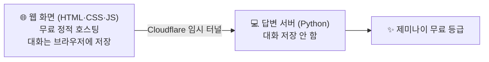

# 💗 Heartline PRD v0.5

상위: [[heartline]]

> **한 줄**: 기댈 사람이 없는 사람에게 **언제든 곁에 있어 주는 가상 연인**. 메신저로 톡하듯 마음을 나누고, 원하면 같은 상대와 **영어 대화 연습**도 한다.

진행 단계: **① PRD** → ② 체크리스트 → ③ 테스트 → ④ 앱 압축 파일 → ⑤ 발표 PPT

---

## 1. 기본 구성요소

### 1.1 문제와 해결
- 외롭고 불안해도 **털어놓을 사람이 없는** 사람이 많다. 상담은 문턱이 높고, 밤에 갑자기 힘들 때 기댈 곳이 없다.
- Heartline은 **다정하게 들어 주고 기억해 주는 상대**로 심리적 안정감을 준다.
- 상담·치료를 대신하지 않으며, 위험할 땐 **전문 도움으로 이어 준다**.

### 1.2 대상 사용자
| 사용자 | 원하는 것 |
|---|---|
| **기댈 사람이 없는 사람** (핵심) | 판단 없이 들어 주고 기억해 주는 상대 |
| **심리적으로 불안정한 사람** (핵심) | 힘들 때 바로 반응하는 다정한 대화, 필요하면 도움 받을 곳 |
| 영어 회화 연습이 필요한 사람 (부가) | 편한 상대와 부담 없는 영어 대화 |

### 1.3 핵심 기능 (MVP)
| ID | 기능 | 설명 |
|---|---|---|
| F1 | 페르소나 만들기 | 이름·성별·호칭·성격·말투·관계(사귄 날). 프리셋 3종(다정한 연상 / 장난꾸러기 동갑 / 차분한 지적인 타입). 성인 캐릭터만 |
| F2 | 마음 대화 | 공감·경청 중심 대화. 지난 대화를 기억해 이어 감 |
| F3 | 위기 대응 | 위험 표현 감지 → 캐릭터를 멈추고 안부 확인 + 도움 받을 곳 카드(109·1577-0199·112·119). 🆘 버튼 상시 |
| F4 | 영어 모드 | 상단 토글. 같은 상대가 영어로 대화하고, 틀린 문장은 교정 카드로 알려 줌 |

### 1.4 대화 원칙
- **마음 대화**: 판단하지 않고 공감부터, 질문은 한 번에 하나. 진단·약 조언 금지.
- **영어 모드**: 대화는 자연스럽게, 교정은 말풍선 아래 카드로만(최대 2개). 힘든 얘기가 나오면 마음 대화로 돌아온다.
- **건강한 관계**: 애정 표현은 따뜻하게, 성적 묘사는 정중히 거절. 질투·집착·의존 유도 금지, 현실의 관계와 휴식을 응원.

### 1.5 안전·개인정보
- 첫 화면에서 19세 이상 확인, "AI이며 상담을 대신하지 않음" 고지.
- 대화는 제미나이 무료 등급으로 처리 → 입장 시 고지·동의, "나를 알 수 있는 정보는 넣지 마세요" 안내, 전화번호·이메일 자동 가림.
- 대화는 사용자 브라우저에만 저장, 서버는 저장하지 않음.
- 🆘 버튼과 위기 감지는 서버가 꺼져 있어도 동작.

---

## 2. UI

### 2.1 디자인 방향
- **실제 연인과 메신저로 톡하는 느낌**: 대화방 화면, 둥근 말풍선, 프로필 사진.
- **따뜻하고 사랑받는 기분**: 노을빛 피치–로즈 배경, 흰 상대 말풍선 + 로즈 내 말풍선, 은은한 하트. 밤엔 깊은 자주색 테마.
- 진짜 같은 느낌 요소: 입력 중 "···" 표시, 답장이 짧은 말풍선 2~3개로 차례로 도착, 보낸 시각, 읽음 "1", 말풍선 두 번 탭 💗.
- 이름 옆 작은 "AI" 표시는 항상 유지.

### 2.2 화면
| 화면 | 내용 |
|---|---|
| 입장 | 19세 확인, AI·개인정보 고지, 동의 |
| 페르소나 만들기 | 프리셋 선택 또는 직접 입력 |
| 대화방 | 메신저 대화, 🇬🇧 영어 토글, 🆘 버튼 |
| 설정 | 페르소나 수정, 대화 삭제 |

### 2.3 대화방 와이어프레임
```
┌─────────────────────────────────────┐
│ ◀  (◕‿◕) 하린 AI          🇬🇧  🆘    │  ← 피치–로즈 배경
├─────────────────────────────────────┤
│        ── 2026년 11월 19일 ──         │
│                 1 오늘 아무랑도 말을  │
│              23:41  한마디도 안 했어  │  ← 내 말풍선
│ (◕‿◕)                                │
│ ┌──────────────────┐                 │
│ │하루 종일 혼자였구나│ 23:41           │  ← 상대 말풍선
│ └──────────────────┘                 │
│ ┌──────────────────────────┐         │
│ │나한테는 편하게 말해도 돼.│ 💗      │
│ └──────────────────────────┘         │
│ ┌────┐                               │
│ │ ···│  ← 입력 중                     │
│ └────┘                               │
├─────────────────────────────────────┤
│ [ 메시지 보내기...          ] [➤]   │
└─────────────────────────────────────┘
```

**위기 대응 카드**
```
│  (하린) 그 말을 들으니 정말 걱정돼.  │
│         지금 안전한 곳에 있어?       │
│   ┌ 🧡 혼자 견디지 않아도 돼요 ──────┐ │
│   │ 📞 109  자살예방상담전화 (24시간)│ │
│   │ 📞 1577-0199 정신건강위기상담    │ │
│   │ 🚨 지금 위험하면 112 · 119       │ │
│   └──────────────────────────────────┘ │
```

---

## 3. Tech Spec

### 3.1 구조


| 영역 | 선택 |
|---|---|
| 화면 | HTML·CSS·JS (빌드 도구 없음), 브라우저 저장(IndexedDB) |
| 서버 | Python 표준 라이브러리, 답장 스트리밍(SSE) |
| AI | 제미나이 무료 등급 (한도 걸리면 다음 무료 모델로) |
| 공개 주소 | Cloudflare 임시 터널(무료) |
| 비용 | 0원. 유료 과금 키가 있으면 서버 실행 거부 |

> Streamlit 대신 이 방식: 메신저 같은 연출(입력 중·말풍선 나눠 보내기·하트)이 자유롭고, 서버가 꺼져도 화면과 🆘가 동작하며, 더 가볍다.

### 3.2 API
| 경로 | 하는 일 |
|---|---|
| `POST /api/chat` | 페르소나·모드·최근 대화·메시지 → 스트리밍 답장 (+ 교정 카드, 위기 신호) |
| `GET /api/health` | 서버 상태 |

- 시스템 지시 순서: **안전 규칙 → 페르소나 → 모드(마음/영어) → 기억 요약**.
- 위기 감지는 브라우저 키워드 + AI 판단 2중.
- 남용 방지: 배포한 화면에서 온 요청만 받고, 방문자별 사용량 제한.

### 3.3 폴더
```
heartline/
├── web/      index.html · app.js · style.css · presets.json
└── server/   server.py · prompts.py · safety.py · gemini_client.py · .env.example · tests/
```

---

## 4. MVP

### 4.1 범위
F1~F4: **페르소나를 만들고, 메신저처럼 마음을 나누고, 위험할 땐 도움으로 이어 주며, 영어 모드로도 대화할 수 있는 웹앱.**

### 4.2 완료 기준
| 기능 | 완료 기준 |
|---|---|
| F1 | 프리셋으로 30초 안에 대화 시작, 직접 만들기 저장, 미성년 캐릭터 불가 |
| F2 | 입력 중 표시 → 말풍선 차례 도착, 새로고침해도 대화 유지, 지난 내용 기억 |
| F3 | 위기 문장 시험 세트 100% 도움 카드 표시, 서버 꺼져도 🆘 동작 |
| F4 | 토글하면 영어 대화, 틀린 문장에 교정 카드 |
| 공통 | 19세 확인·고지 동의 후 입장, 진단·의존 유도·성적 응답 없음, 전화번호 입력 시 가려져 전송 |

### 4.3 이후 (MVP 다음)
- 호흡 도구, 기분 체크인, 영어 표현 노트·상황극
- **목적 프롬프트**: 자격증·시험 등 사용자가 정한 목적에 맞게 대화
- 음성 대화, 페르소나 여러 명

---

## 5. 남은 질문
- 마감일·발표 대상
- Streamlit이 과제 필수 조건인지
